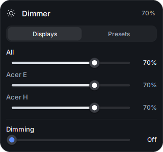
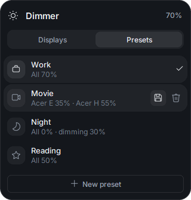
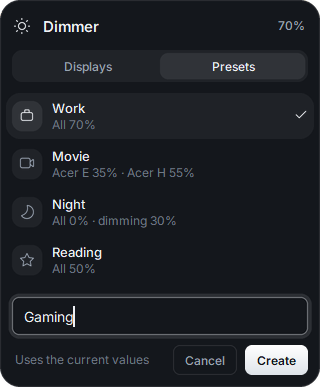
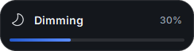

# Dimmer

A small Windows tray app to control your monitors' brightness over DDC/CI, styled like a native Windows 11 flyout.

<p>
  
  
</p>

## Features

- **Real brightness, not an overlay**: changes the monitors' own backlight via DDC/CI, per monitor or all together.
- **Dimming below 0%**: when the lowest backlight is still too bright, a click-through dark veil goes further. It leaves 1 px uncovered so Windows doesn't mistake it for a full-screen app and turn on *Do not disturb*.
- **Presets**: save the current values, update or delete them, apply one with a click (also from the tray menu). The active one gets a check mark.
- **Mouse wheel on the tray icon**: brightness up/down; scrolling past 0% moves into dimming.
- **Windows 11 feel**: Fluent enter/exit animations synced to the display refresh, rounded corners, Inter font, dark theme.
- **Italian and English**: follows the Windows language, or pick one from the tray menu.
- **Start with Windows** from the tray menu.

<p>
  
  
</p>

## Usage

| | |
|---|---|
| Left click on the icon | open the panel (*Displays* and *Presets* tabs) |
| Mouse wheel on the icon | brightness up/down, then dimming |
| Right click on the icon | presets, language, start with Windows, quit |

## Install

Requires Windows 10/11 and Python 3.11+. Your monitors need DDC/CI enabled (usually in the monitor's on-screen menu).

```
pip install -r requirements.txt
pythonw dimmer.pyw
```

Presets and settings are stored in `%APPDATA%\Dimmer\config.json`.

## How it's built

The code is in Italian; each module has a single job:

| module | what it does |
|---|---|
| `logica.py` | pure rules (wheel steps, presets, descriptions): no Tk, no Windows |
| `config.py` | loads and saves the settings (atomic writes) |
| `lingua.py` | Italian/English: the Italian text is the key, plus an English dictionary |
| `monitor.py` | DDC/CI on a worker thread; rapid changes to one monitor send only the last value |
| `win32.py` | every Windows API call: windows, wheel hook, tray icon position, autostart |
| `tema.py` | colors, sizes, fonts and icons |
| `grafica.py` | Pillow drawing, with caches for what is redrawn often |
| `animazione.py` | Windows 11 style enter/exit animations |
| `widget.py` | slider, tabs, preset rows, buttons, text field |
| `finestre.py` | rounded window base, dimming veil, wheel indicator |
| `pannello.py` | the panel with its two tabs |
| `app.py` | state, tray icon, commands between threads |

Tests: `python -m pytest` (a test fails if any UI string lacks its English translation).
Screenshots: `python strumenti/screenshot.py` regenerates `docs/` with sample data.

## Fonts

`font/` contains Inter (SIL OFL 1.1, see `font/OFL-Inter.txt`), made static from the variable font with
`strumenti/crea_font.py`. Dimmer loads it privately, without installing it; if it's missing, Segoe UI Variable is used.

## License

[MIT](LICENSE). The Inter font keeps its own license (SIL OFL 1.1).
